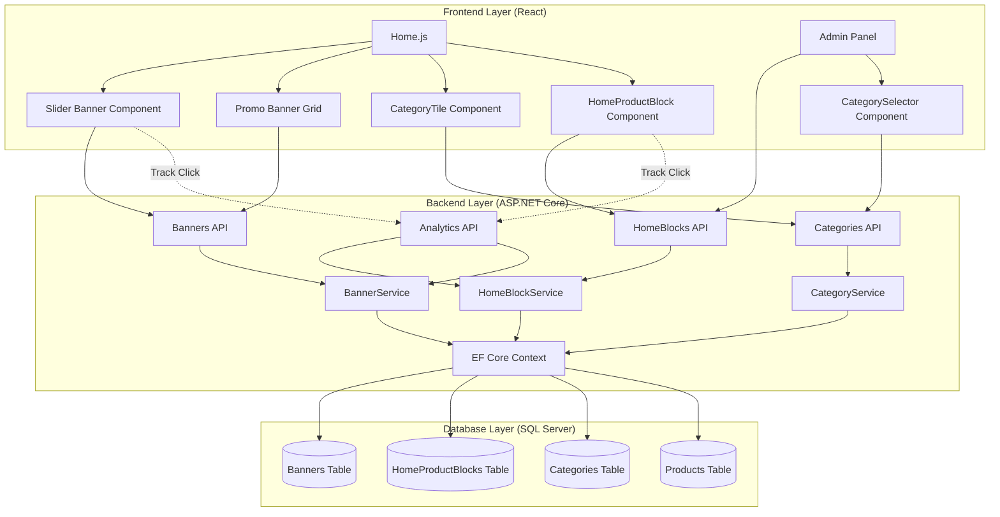
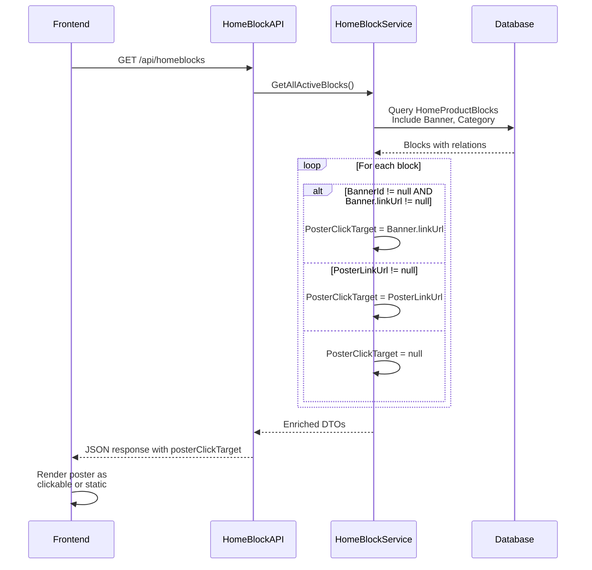
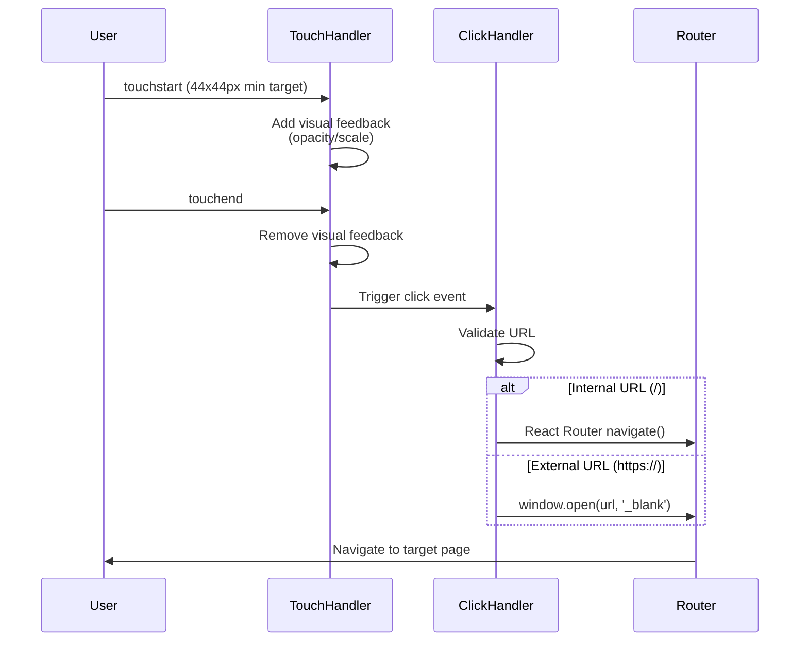
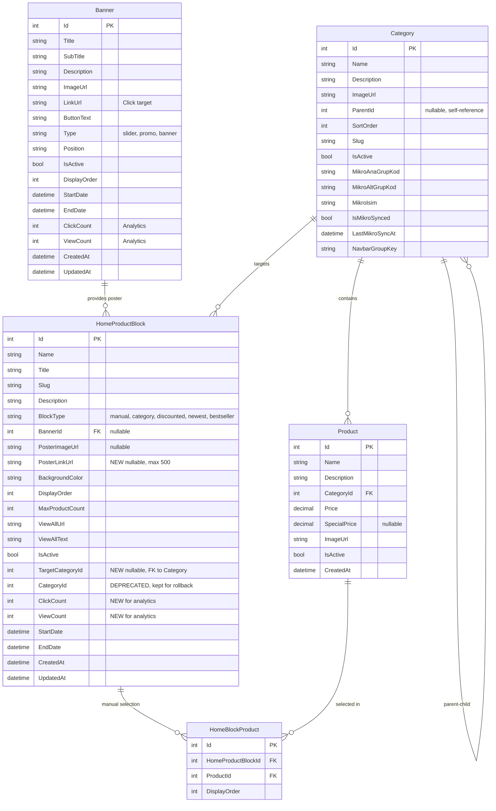

# Technical Design Document

## Overview

This document specifies the technical design for making all homepage visual elements (slider banners, category tiles, promo banners, and product block posters) clickable, adding subcategory support, and ensuring full mobile compatibility. The design builds upon existing Banner and HomeProductBlock entities while introducing new fields and navigation logic to support comprehensive click-through functionality.

### Key Design Goals

1. **Backward Compatibility**: Preserve existing Banner.linkUrl functionality while extending HomeProductBlock with poster click targets
2. **Hierarchical Category Support**: Enable admin to select parent or child categories for product blocks
3. **Mobile-First Approach**: Ensure touch-friendly interactions with proper visual feedback and responsive layouts
4. **Performance**: Optimize queries with proper indexing and caching strategies
5. **Analytics**: Track clicks and views for banners and blocks to measure engagement

### Design Principles

- **Progressive Enhancement**: Existing banner functionality remains unchanged; new features layer on top
- **Separation of Concerns**: Click logic separated between Banner (reusable asset) and HomeProductBlock (context-specific usage)
- **Explicit Priority**: When both BannerId and PosterLinkUrl exist, Banner.linkUrl takes precedence
- **Graceful Degradation**: Missing click targets render as non-interactive visuals without errors

## Architecture

### High-Level Component Diagram



### Data Flow: Poster Click Target Resolution



### Mobile Touch Event Flow



## Components and Interfaces

### Backend Components

#### 1. Entity Updates

**HomeProductBlock.cs - New Fields**

```csharp
public class HomeProductBlock
{
    // ... existing fields ...

    /// <summary>
    /// Direct poster click target URL (alternative to Banner.linkUrl)
    /// Takes precedence when BannerId is null
    /// Max length: 500 characters
    /// Examples: "/category/milk-products", "https://example.com/campaign"
    /// </summary>
    [MaxLength(500)]
    public string? PosterLinkUrl { get; set; }

    /// <summary>
    /// Target category for this block (replaces deprecated CategoryId)
    /// Supports both parent and subcategories
    /// When parent: includes all subcategory products
    /// When subcategory: includes only that subcategory products
    /// </summary>
    public int? TargetCategoryId { get; set; }

    /// <summary>
    /// Poster click count for analytics
    /// Incremented via track-click endpoint
    /// </summary>
    public int ClickCount { get; set; } = 0;

    /// <summary>
    /// Block view count for analytics
    /// Incremented via track-view endpoint (Intersection Observer)
    /// </summary>
    public int ViewCount { get; set; } = 0;

    // Navigation property for TargetCategoryId
    [ForeignKey("TargetCategoryId")]
    public virtual Category? TargetCategory { get; set; }

    // ... existing navigation properties ...
}
```

**Migration Strategy for CategoryId → TargetCategoryId**

```csharp
// Migration: AddTargetCategoryIdToHomeProductBlock
public partial class AddTargetCategoryIdToHomeProductBlock : Migration
{
    protected override void Up(MigrationBuilder migrationBuilder)
    {
        // 1. Add new columns
        migrationBuilder.AddColumn<string>(
            name: "PosterLinkUrl",
            table: "HomeProductBlocks",
            type: "nvarchar(500)",
            maxLength: 500,
            nullable: true);

        migrationBuilder.AddColumn<int>(
            name: "TargetCategoryId",
            table: "HomeProductBlocks",
            type: "int",
            nullable: true);

        migrationBuilder.AddColumn<int>(
            name: "ClickCount",
            table: "HomeProductBlocks",
            type: "int",
            nullable: false,
            defaultValue: 0);

        migrationBuilder.AddColumn<int>(
            name: "ViewCount",
            table: "HomeProductBlocks",
            type: "int",
            nullable: false,
            defaultValue: 0);

        // 2. Copy existing CategoryId to TargetCategoryId for backward compatibility
        migrationBuilder.Sql(
            @"UPDATE HomeProductBlocks
              SET TargetCategoryId = CategoryId
              WHERE CategoryId IS NOT NULL");

        // 3. Add foreign key constraint with SET NULL on delete
        migrationBuilder.AddForeignKey(
            name: "FK_HomeProductBlocks_Categories_TargetCategoryId",
            table: "HomeProductBlocks",
            column: "TargetCategoryId",
            principalTable: "Categories",
            principalColumn: "Id",
            onDelete: ReferentialAction.SetNull);

        // 4. Add index for query performance
        migrationBuilder.CreateIndex(
            name: "IX_HomeProductBlocks_TargetCategoryId",
            table: "HomeProductBlocks",
            column: "TargetCategoryId");

        // 5. Mark CategoryId as obsolete (DO NOT DROP - deprecation period)
        // CategoryId column remains for rollback safety
    }

    protected override void Down(MigrationBuilder migrationBuilder)
    {
        migrationBuilder.DropForeignKey(
            name: "FK_HomeProductBlocks_Categories_TargetCategoryId",
            table: "HomeProductBlocks");

        migrationBuilder.DropIndex(
            name: "IX_HomeProductBlocks_TargetCategoryId",
            table: "HomeProductBlocks");

        migrationBuilder.DropColumn(name: "PosterLinkUrl", table: "HomeProductBlocks");
        migrationBuilder.DropColumn(name: "TargetCategoryId", table: "HomeProductBlocks");
        migrationBuilder.DropColumn(name: "ClickCount", table: "HomeProductBlocks");
        migrationBuilder.DropColumn(name: "ViewCount", table: "HomeProductBlocks");
    }
}
```

#### 2. DTOs

**CreateHomeBlockDto.cs**

```csharp
public class CreateHomeBlockDto
{
    [Required]
    [MaxLength(100)]
    public string Name { get; set; } = string.Empty;

    [MaxLength(200)]
    public string? Title { get; set; }

    [Required]
    [MaxLength(150)]
    public string Slug { get; set; } = string.Empty;

    public string? Description { get; set; }

    [Required]
    public string BlockType { get; set; } = "manual"; // manual, category, discounted, newest, bestseller

    public int? BannerId { get; set; }

    [MaxLength(500)]
    public string? PosterImageUrl { get; set; }

    /// <summary>
    /// New: Direct poster click URL (optional)
    /// Validated to start with http://, https://, or /
    /// </summary>
    [MaxLength(500)]
    [RegularExpression(@"^(https?://|/)", ErrorMessage = "URL must start with http://, https://, or /")]
    public string? PosterLinkUrl { get; set; }

    [MaxLength(7)]
    [RegularExpression(@"^#[0-9A-Fa-f]{6}$", ErrorMessage = "Must be valid hex color")]
    public string? BackgroundColor { get; set; }

    public int DisplayOrder { get; set; } = 0;

    [Range(1, 50)]
    public int MaxProductCount { get; set; } = 6;

    [MaxLength(300)]
    public string? ViewAllUrl { get; set; }

    [MaxLength(50)]
    public string ViewAllText { get; set; } = "Tümünü Gör";

    public bool IsActive { get; set; } = true;

    /// <summary>
    /// New: Target category ID (supports parent and subcategories)
    /// Replaces deprecated CategoryId
    /// </summary>
    public int? TargetCategoryId { get; set; }

    public DateTime? StartDate { get; set; }
    public DateTime? EndDate { get; set; }

    // For manual blocks
    public List<int>? ProductIds { get; set; }
}
```

**UpdateHomeBlockDto.cs**

```csharp
public class UpdateHomeBlockDto
{
    [Required]
    public int Id { get; set; }

    // Same fields as CreateHomeBlockDto
    // ... (include PosterLinkUrl and TargetCategoryId)
}
```

**HomeProductBlockDto.cs (Response)**

```csharp
public class HomeProductBlockDto
{
    public int Id { get; set; }
    public string Name { get; set; } = string.Empty;
    public string? Title { get; set; }
    public string Slug { get; set; } = string.Empty;
    public string? Description { get; set; }
    public string BlockType { get; set; } = string.Empty;

    public int? BannerId { get; set; }
    public string? PosterImageUrl { get; set; }
    public string? PosterLinkUrl { get; set; }

    /// <summary>
    /// Computed field: resolved poster click target
    /// Priority: Banner.linkUrl > PosterLinkUrl > null
    /// </summary>
    public string? PosterClickTarget { get; set; }

    public string? BackgroundColor { get; set; }
    public int DisplayOrder { get; set; }
    public int MaxProductCount { get; set; }
    public string? ViewAllUrl { get; set; }
    public string ViewAllText { get; set; } = string.Empty;
    public bool IsActive { get; set; }

    public int? TargetCategoryId { get; set; }

    /// <summary>
    /// Enriched category information
    /// Includes breadcrumb for subcategories: "Parent > Subcategory"
    /// </summary>
    public CategoryBreadcrumbDto? TargetCategoryInfo { get; set; }

    public DateTime? StartDate { get; set; }
    public DateTime? EndDate { get; set; }
    public DateTime CreatedAt { get; set; }
    public DateTime? UpdatedAt { get; set; }

    public int ClickCount { get; set; }
    public int ViewCount { get; set; }

    /// <summary>
    /// Click-Through Rate: (ClickCount / ViewCount) * 100
    /// Returns 0 if ViewCount is 0
    /// </summary>
    public decimal ClickThroughRate { get; set; }

    public BannerDto? Banner { get; set; }
    public List<ProductDto> Products { get; set; } = new();
}
```

**CategoryBreadcrumbDto.cs**

```csharp
public class CategoryBreadcrumbDto
{
    public int Id { get; set; }
    public string Name { get; set; } = string.Empty;
    public string Slug { get; set; } = string.Empty;
    public bool IsSubcategory { get; set; }

    /// <summary>
    /// Parent category info (if this is a subcategory)
    /// </summary>
    public CategoryBreadcrumbDto? Parent { get; set; }

    /// <summary>
    /// Formatted breadcrumb string
    /// Examples: "Süt Ürünleri", "Gıda > Süt Ürünleri"
    /// </summary>
    public string Breadcrumb { get; set; } = string.Empty;
}
```

#### 3. Service Layer

**IHomeBlockService.cs - New Methods**

```csharp
public interface IHomeBlockService
{
    // ... existing methods ...

    /// <summary>
    /// Resolves poster click target for a block
    /// Priority: Banner.linkUrl > PosterLinkUrl > null
    /// </summary>
    Task<string?> GetPosterClickTargetAsync(int blockId);

    /// <summary>
    /// Gets all active blocks with enriched data for public display
    /// Includes: resolved posterClickTarget, category breadcrumbs, products
    /// Filters: IsActive = true, date range, active TargetCategory
    /// </summary>
    Task<List<HomeProductBlockDto>> GetAllActiveBlocksAsync();

    /// <summary>
    /// Gets products for a block based on BlockType and TargetCategoryId
    /// Handles parent category (includes subcategories) vs subcategory (only that category)
    /// </summary>
    Task<List<Product>> GetBlockProductsAsync(int blockId, int maxCount);

    /// <summary>
    /// Tracks poster click for analytics
    /// Increments ClickCount asynchronously
    /// </summary>
    Task TrackPosterClickAsync(int blockId);

    /// <summary>
    /// Tracks block view for analytics
    /// Increments ViewCount asynchronously
    /// </summary>
    Task TrackBlockViewAsync(int blockId);

    /// <summary>
    /// Validates TargetCategoryId exists and is active
    /// Returns validation result with error message
    /// </summary>
    Task<(bool IsValid, string? ErrorMessage)> ValidateTargetCategoryAsync(int? categoryId);
}
```

**HomeBlockService.cs - Implementation Highlights**

```csharp
public class HomeBlockService : IHomeBlockService
{
    private readonly ApplicationDbContext _context;
    private readonly IMemoryCache _cache;

    public async Task<string?> GetPosterClickTargetAsync(int blockId)
    {
        var block = await _context.HomeProductBlocks
            .Include(b => b.Banner)
            .FirstOrDefaultAsync(b => b.Id == blockId);

        if (block == null) return null;

        // Priority 1: Banner.linkUrl
        if (block.BannerId != null &&
            block.Banner != null &&
            !string.IsNullOrWhiteSpace(block.Banner.LinkUrl))
        {
            return block.Banner.LinkUrl;
        }

        // Priority 2: PosterLinkUrl
        if (!string.IsNullOrWhiteSpace(block.PosterLinkUrl))
        {
            return block.PosterLinkUrl;
        }

        return null;
    }

    public async Task<List<Product>> GetBlockProductsAsync(int blockId, int maxCount)
    {
        var block = await _context.HomeProductBlocks
            .Include(b => b.TargetCategory)
            .FirstOrDefaultAsync(b => b.Id == blockId);

        if (block == null) return new List<Product>();

        IQueryable<Product> query = _context.Products.Where(p => p.IsActive);

        switch (block.BlockType.ToLower())
        {
            case "manual":
                // Use BlockProducts junction table
                var productIds = await _context.HomeBlockProducts
                    .Where(bp => bp.HomeProductBlockId == blockId)
                    .OrderBy(bp => bp.DisplayOrder)
                    .Select(bp => bp.ProductId)
                    .ToListAsync();
                query = query.Where(p => productIds.Contains(p.Id));
                break;

            case "category":
                if (block.TargetCategoryId == null) break;

                var targetCategory = block.TargetCategory;
                if (targetCategory == null) break;

                // Check if parent category (includes subcategories)
                if (!targetCategory.ParentId.HasValue)
                {
                    // Parent category: include all products from this category AND subcategories
                    var subcategoryIds = await _context.Categories
                        .Where(c => c.ParentId == block.TargetCategoryId && c.IsActive)
                        .Select(c => c.Id)
                        .ToListAsync();

                    var allCategoryIds = new List<int> { block.TargetCategoryId.Value };
                    allCategoryIds.AddRange(subcategoryIds);

                    query = query.Where(p => allCategoryIds.Contains(p.CategoryId));
                }
                else
                {
                    // Subcategory: only products from this specific subcategory
                    query = query.Where(p => p.CategoryId == block.TargetCategoryId);
                }
                break;

            case "discounted":
                query = query.Where(p => p.SpecialPrice != null && p.SpecialPrice < p.Price);
                query = query.OrderBy(p => (p.Price - p.SpecialPrice) / p.Price); // Biggest discount first
                break;

            case "newest":
                query = query.OrderByDescending(p => p.CreatedAt);
                break;

            case "bestseller":
                // TODO: Implement when order tracking is added
                query = query.OrderByDescending(p => p.CreatedAt); // Fallback
                break;
        }

        return await query.Take(maxCount).ToListAsync();
    }

    public async Task<(bool IsValid, string? ErrorMessage)> ValidateTargetCategoryAsync(int? categoryId)
    {
        if (categoryId == null) return (true, null);

        var category = await _context.Categories.FindAsync(categoryId);

        if (category == null)
            return (false, "Seçilen kategori bulunamadı.");

        if (!category.IsActive)
            return (false, "Seçilen kategori pasif durumda.");

        return (true, null);
    }

    // Caching implementation for GetAllActiveBlocksAsync
    public async Task<List<HomeProductBlockDto>> GetAllActiveBlocksAsync()
    {
        const string cacheKey = "active_home_blocks";

        if (_cache.TryGetValue(cacheKey, out List<HomeProductBlockDto>? cachedBlocks))
        {
            return cachedBlocks!;
        }

        var now = DateTime.UtcNow;
        var blocks = await _context.HomeProductBlocks
            .Include(b => b.Banner)
            .Include(b => b.TargetCategory)
                .ThenInclude(c => c.Parent)
            .Where(b => b.IsActive &&
                       (b.StartDate == null || b.StartDate <= now) &&
                       (b.EndDate == null || b.EndDate >= now) &&
                       (b.TargetCategoryId == null || b.TargetCategory!.IsActive))
            .OrderBy(b => b.DisplayOrder)
            .ToListAsync();

        var dtos = new List<HomeProductBlockDto>();

        foreach (var block in blocks)
        {
            var dto = MapToDto(block);
            dto.PosterClickTarget = await GetPosterClickTargetAsync(block.Id);
            dto.Products = (await GetBlockProductsAsync(block.Id, block.MaxProductCount))
                .Select(MapProductToDto)
                .ToList();
            dto.ClickThroughRate = block.ViewCount > 0
                ? Math.Round((decimal)block.ClickCount / block.ViewCount * 100, 2)
                : 0;
            dtos.Add(dto);
        }

        var cacheOptions = new MemoryCacheEntryOptions()
            .SetAbsoluteExpiration(TimeSpan.FromMinutes(5));
        _cache.Set(cacheKey, dtos, cacheOptions);

        return dtos;
    }

    // Analytics tracking methods (async, fire-and-forget)
    public async Task TrackPosterClickAsync(int blockId)
    {
        var block = await _context.HomeProductBlocks.FindAsync(blockId);
        if (block != null)
        {
            block.ClickCount++;
            await _context.SaveChangesAsync();
            InvalidateCache();
        }
    }

    public async Task TrackBlockViewAsync(int blockId)
    {
        var block = await _context.HomeProductBlocks.FindAsync(blockId);
        if (block != null)
        {
            block.ViewCount++;
            await _context.SaveChangesAsync();
            InvalidateCache();
        }
    }

    private void InvalidateCache()
    {
        _cache.Remove("active_home_blocks");
    }
}
```

#### 4. API Controllers

**HomeBlocksController.cs - New Endpoints**

```csharp
[ApiController]
[Route("api/[controller]")]
public class HomeBlocksController : ControllerBase
{
    private readonly IHomeBlockService _homeBlockService;

    /// <summary>
    /// GET /api/homeblocks - Public endpoint for active blocks
    /// Returns enriched blocks with posterClickTarget and products
    /// Cached for 5 minutes
    /// </summary>
    [HttpGet]
    [ResponseCache(Duration = 300)] // 5 minutes
    public async Task<ActionResult<List<HomeProductBlockDto>>> GetActiveBlocks()
    {
        var blocks = await _homeBlockService.GetAllActiveBlocksAsync();
        return Ok(blocks);
    }

    /// <summary>
    /// POST /api/homeblocks/{id}/track-click - Track poster click
    /// Async analytics endpoint, returns immediately
    /// </summary>
    [HttpPost("{id}/track-click")]
    public async Task<IActionResult> TrackClick(int id)
    {
        _ = _homeBlockService.TrackPosterClickAsync(id); // Fire and forget
        return NoContent();
    }

    /// <summary>
    /// POST /api/homeblocks/{id}/track-view - Track block view
    /// Called when block enters viewport (Intersection Observer)
    /// </summary>
    [HttpPost("{id}/track-view")]
    public async Task<IActionResult> TrackView(int id)
    {
        _ = _homeBlockService.TrackBlockViewAsync(id); // Fire and forget
        return NoContent();
    }

    /// <summary>
    /// POST /api/homeblocks - Create new block (Admin only)
    /// Validates TargetCategoryId if provided
    /// </summary>
    [HttpPost]
    [Authorize(Roles = "Admin")]
    public async Task<ActionResult<HomeProductBlockDto>> CreateBlock(
        [FromBody] CreateHomeBlockDto dto)
    {
        // Validate TargetCategoryId
        var (isValid, errorMessage) = await _homeBlockService.ValidateTargetCategoryAsync(dto.TargetCategoryId);
        if (!isValid)
        {
            return BadRequest(new { error = errorMessage });
        }

        var block = await _homeBlockService.CreateAsync(dto);
        return CreatedAtAction(nameof(GetBlockById), new { id = block.Id }, block);
    }

    /// <summary>
    /// PUT /api/homeblocks/{id} - Update block (Admin only)
    /// Validates TargetCategoryId if changed
    /// </summary>
    [HttpPut("{id}")]
    [Authorize(Roles = "Admin")]
    public async Task<ActionResult<HomeProductBlockDto>> UpdateBlock(
        int id,
        [FromBody] UpdateHomeBlockDto dto)
    {
        if (id != dto.Id)
            return BadRequest("ID mismatch");

        var (isValid, errorMessage) = await _homeBlockService.ValidateTargetCategoryAsync(dto.TargetCategoryId);
        if (!isValid)
        {
            return BadRequest(new { error = errorMessage });
        }

        var block = await _homeBlockService.UpdateAsync(dto);
        return Ok(block);
    }

    // ... other CRUD endpoints ...
}
```

**BannersController.cs - Analytics Endpoint**

```csharp
[ApiController]
[Route("api/[controller]")]
public class BannersController : ControllerBase
{
    private readonly IBannerService _bannerService;

    /// <summary>
    /// POST /api/banners/{id}/track-click - Track banner click
    /// Increments Banner.ClickCount for analytics
    /// </summary>
    [HttpPost("{id}/track-click")]
    public async Task<IActionResult> TrackClick(int id)
    {
        await _bannerService.IncrementClickCountAsync(id);
        return NoContent();
    }

    // ... existing endpoints ...
}
```

### Frontend Components

#### 1. Home.js Updates

**Slider Banner Click Handling**

```jsx
// Home.js - Slider Banner Section
<section className="mb-4">
  {sliderPosters.length > 0 ? (
    <div style={{ position: "relative", borderRadius: 12, overflow: "hidden" }}>
      <div style={{ position: "relative", height: 300, width: "100%" }}>
        {sliderPosters.map((poster, idx) => {
          const isExternal = poster.linkUrl?.startsWith('http');
          const BannerWrapper = poster.linkUrl
            ? (isExternal ? 'a' : Link)
            : 'div';

          const wrapperProps = poster.linkUrl
            ? (isExternal
                ? {
                    href: poster.linkUrl,
                    target: "_blank",
                    rel: "noopener noreferrer",
                    onClick: () => trackBannerClick(poster.id)
                  }
                : {
                    to: poster.linkUrl,
                    onClick: () => trackBannerClick(poster.id)
                  })
            : {};

          return (
            <BannerWrapper
              key={poster.id}
              {...wrapperProps}
              style={{
                position: "absolute",
                top: 0,
                left: 0,
                width: "100%",
                height: "100%",
                opacity: idx === currentSlide ? 1 : 0,
                visibility: idx === currentSlide ? "visible" : "hidden",
                transition: "opacity 0.5s ease-in-out",
                cursor: poster.linkUrl ? "pointer" : "default",
                touchAction: "manipulation", // Prevent zoom on double-tap
              }}
              onMouseEnter={(e) => {
                if (poster.linkUrl) {
                  e.currentTarget.style.transform = "scale(1.02)";
                  e.currentTarget.style.transition = "transform 0.2s";
                }
              }}
              onMouseLeave={(e) => {
                if (poster.linkUrl) {
                  e.currentTarget.style.transform = "scale(1)";
                }
              }}
            >
               {
                  e.target.style.background = "#e5e7eb";
                  e.target.alt = poster.title || "Banner";
                }}
              />
            </BannerWrapper>
          );
        })}
      </div>
      {/* Navigation buttons remain unchanged */}
    </div>
  ) : (
    // Fallback hero section remains unchanged
  )}
</section>
```

**Promo Banner Grid**

```jsx
// Home.js - Promo Banner Section
{
  promoPosters.length > 0 && (
    <section className="mb-4">
      <h2 style={{ fontSize: "1.25rem", fontWeight: 600, marginBottom: 12 }}>
        <i className="fas fa-tags me-2" style={{ color: "#f97316" }}></i>
        Kampanyalar
      </h2>
      <div
        style={{
          display: "grid",
          gridTemplateColumns: "repeat(auto-fill, minmax(150px, 1fr))",
          gap: 12,
        }}
      >
        {promoPosters.map((promo) => {
          const isExternal = promo.linkUrl?.startsWith("http");
          const PromoWrapper = promo.linkUrl
            ? isExternal
              ? "a"
              : Link
            : "div";

          const wrapperProps = promo.linkUrl
            ? isExternal
              ? {
                  href: promo.linkUrl,
                  target: "_blank",
                  rel: "noopener noreferrer",
                  onClick: () => trackBannerClick(promo.id),
                }
              : {
                  to: promo.linkUrl,
                  onClick: () => trackBannerClick(promo.id),
                }
            : {};

          return (
            <PromoWrapper
              key={promo.id}
              {...wrapperProps}
              style={{
                display: "block",
                borderRadius: 8,
                overflow: "hidden",
                boxShadow: "0 2px 4px rgba(0,0,0,0.1)",
                transition: "transform 0.2s",
                aspectRatio: "4/3",
                cursor: promo.linkUrl ? "pointer" : "default",
                touchAction: "manipulation",
              }}
              onMouseEnter={(e) => {
                if (promo.linkUrl) {
                  e.currentTarget.style.transform = "translateY(-4px)";
                }
              }}
              onMouseLeave={(e) => {
                if (promo.linkUrl) {
                  e.currentTarget.style.transform = "translateY(0)";
                }
              }}
            >
               {
                  e.target.style.background = "#f3f4f6";
                  e.target.alt = promo.title || "Promo";
                }}
              />
            </PromoWrapper>
          );
        })}
      </div>
    </section>
  );
}
```

**Analytics Tracking Helper**

```jsx
// Home.js - Analytics functions
const trackBannerClick = async (bannerId) => {
  try {
    await api.post(`/api/banners/${bannerId}/track-click`);
  } catch (err) {
    console.error("Failed to track banner click:", err);
    // Fail silently - don't block navigation
  }
};

const trackBlockView = async (blockId) => {
  try {
    await api.post(`/api/homeblocks/${blockId}/track-view`);
  } catch (err) {
    console.error("Failed to track block view:", err);
  }
};

const trackPosterClick = async (blockId) => {
  try {
    await api.post(`/api/homeblocks/${blockId}/track-click`);
  } catch (err) {
    console.error("Failed to track poster click:", err);
  }
};
```

#### 2. HomeProductBlock Component (New)

**HomeProductBlock.jsx**

```jsx
import React, { useEffect, useRef, useState } from "react";
import { Link } from "react-router-dom";
import ProductCard from "./ProductCard";

export default function HomeProductBlock({
  block,
  onToggleFavorite,
  favorites,
  onAddToCart,
}) {
  const blockRef = useRef(null);
  const [hasTrackedView, setHasTrackedView] = useState(false);

  // Intersection Observer for view tracking
  useEffect(() => {
    if (!blockRef.current || hasTrackedView) return;

    const observer = new IntersectionObserver(
      (entries) => {
        entries.forEach((entry) => {
          if (entry.isIntersecting && !hasTrackedView) {
            trackBlockView(block.id);
            setHasTrackedView(true);
          }
        });
      },
      { threshold: 0.5 }, // 50% visible
    );

    observer.observe(blockRef.current);

    return () => observer.disconnect();
  }, [block.id, hasTrackedView]);

  const trackBlockView = async (blockId) => {
    try {
      await fetch(`/api/homeblocks/${blockId}/track-view`, { method: "POST" });
    } catch (err) {
      console.error("Failed to track block view:", err);
    }
  };

  const trackPosterClick = async () => {
    try {
      await fetch(`/api/homeblocks/${block.id}/track-click`, {
        method: "POST",
      });
    } catch (err) {
      console.error("Failed to track poster click:", err);
    }
  };

  const isExternal = block.posterClickTarget?.startsWith("http");
  const PosterWrapper = block.posterClickTarget
    ? isExternal
      ? "a"
      : Link
    : "div";

  const posterProps = block.posterClickTarget
    ? isExternal
      ? {
          href: block.posterClickTarget,
          target: "_blank",
          rel: "noopener noreferrer",
          onClick: trackPosterClick,
        }
      : {
          to: block.posterClickTarget,
          onClick: trackPosterClick,
        }
    : {};

  return (
    <section ref={blockRef} className="mb-4">
      {/* Block Title */}
      <div
        style={{
          display: "flex",
          justifyContent: "space-between",
          alignItems: "center",
          marginBottom: 12,
        }}
      >
        <h2 style={{ fontSize: "1.25rem", fontWeight: 600, margin: 0 }}>
          {block.title || block.name}
        </h2>
        {block.viewAllUrl && (
          <Link
            to={block.viewAllUrl}
            style={{
              fontSize: "0.875rem",
              color: "#3b82f6",
              textDecoration: "none",
              display: "flex",
              alignItems: "center",
              gap: 4,
            }}
          >
            {block.viewAllText}
            <i
              className="fas fa-arrow-right"
              style={{ fontSize: "0.75rem" }}
            ></i>
          </Link>
        )}
      </div>

      {/* Desktop Layout: Poster (30%) + Products (70%) */}
      <div className="d-none d-md-flex" style={{ gap: 16 }}>
        {/* Poster */}
        {(block.posterImageUrl || block.banner?.imageUrl) && (
          <PosterWrapper
            {...posterProps}
            style={{
              flex: "0 0 30%",
              borderRadius: 12,
              overflow: "hidden",
              boxShadow: "0 4px 6px rgba(0,0,0,0.1)",
              cursor: block.posterClickTarget ? "pointer" : "default",
              touchAction: "manipulation",
              transition: "transform 0.2s",
            }}
            onMouseEnter={(e) => {
              if (block.posterClickTarget) {
                e.currentTarget.style.transform = "scale(1.02)";
              }
            }}
            onMouseLeave={(e) => {
              if (block.posterClickTarget) {
                e.currentTarget.style.transform = "scale(1)";
              }
            }}
          >
             {
                e.target.style.background = block.backgroundColor || "#e5e7eb";
                e.target.alt = block.title || "Poster";
              }}
            />
          </PosterWrapper>
        )}

        {/* Products Grid */}
        <div
          style={{
            flex: "1",
            display: "grid",
            gridTemplateColumns: "repeat(auto-fill, minmax(130px, 1fr))",
            gap: 10,
          }}
        >
          {block.products?.map((product) => (
            <ProductCard
              key={product.id}
              product={product}
              onToggleFavorite={onToggleFavorite}
              isFavorite={favorites?.includes(product.id)}
              onAddToCart={onAddToCart}
              cardMaxWidth="220px"
            />
          ))}
        </div>
      </div>

      {/* Mobile Layout: Poster (full width) + Products (stacked) */}
      <div className="d-md-none">
        {/* Poster */}
        {(block.posterImageUrl || block.banner?.imageUrl) && (
          <PosterWrapper
            {...posterProps}
            style={{
              display: "block",
              borderRadius: 12,
              overflow: "hidden",
              boxShadow: "0 4px 6px rgba(0,0,0,0.1)",
              marginBottom: 12,
              cursor: block.posterClickTarget ? "pointer" : "default",
              touchAction: "manipulation",
            }}
          >
             {
                e.target.style.background = block.backgroundColor || "#e5e7eb";
                e.target.alt = block.title || "Poster";
              }}
            />
          </PosterWrapper>
        )}

        {/* Products Grid */}
        <div
          style={{
            display: "grid",
            gridTemplateColumns: "repeat(auto-fill, minmax(130px, 1fr))",
            gap: 10,
          }}
        >
          {block.products?.map((product) => (
            <ProductCard
              key={product.id}
              product={product}
              onToggleFavorite={onToggleFavorite}
              isFavorite={favorites?.includes(product.id)}
              onAddToCart={onAddToCart}
              cardMaxWidth="220px"
            />
          ))}
        </div>
      </div>
    </section>
  );
}
```

#### 3. CategoryTile Updates

**Updated CategoryTile.jsx**

The existing CategoryTile already handles click navigation and mobile megamenu. Key updates needed:

1. Ensure minimum touch target size (44x44px)
2. Add visual touch feedback
3. Proper aria-labels with category info

```jsx
// CategoryTile.jsx - Touch feedback enhancements
<div
  onClick={handleClick}
  onKeyDown={handleKeyDown}
  tabIndex={0}
  role="button"
  aria-expanded={showMegamenu}
  aria-label={`${category?.name} kategorisi${hasSubcategories ? " - alt kategoriler mevcut" : ""}`}
  className="border p-3 rounded shadow-sm hover:shadow transition cursor-pointer text-center bg-white h-100"
  style={{
    outline: "none",
    textDecoration: "none",
    minWidth: 44, // Touch target minimum
    minHeight: 44,
    touchAction: "manipulation", // Prevent zoom
  }}
  onTouchStart={(e) => {
    e.currentTarget.style.opacity = "0.7";
  }}
  onTouchEnd={(e) => {
    e.currentTarget.style.opacity = "1";
  }}
>
  {/* Existing content remains the same */}
</div>
```

#### 4. Admin Panel - CategorySelector Component (New)

**CategorySelector.jsx**

```jsx
import React, { useState, useEffect } from "react";
import api from "../../services/api";

export default function CategorySelector({ value, onChange, name }) {
  const [categories, setCategories] = useState([]);
  const [expandedParents, setExpandedParents] = useState(new Set());
  const [searchTerm, setSearchTerm] = useState("");
  const [loading, setLoading] = useState(true);

  useEffect(() => {
    loadCategories();
  }, []);

  const loadCategories = async () => {
    try {
      setLoading(true);
      const rootResponse = await api.get("/api/categories/root");
      const rootCats = rootResponse.data || rootResponse;

      // Load subcategories for each parent
      const catsWithSubs = await Promise.all(
        rootCats.map(async (root) => {
          try {
            const subResponse = await api.get(
              `/api/categories/${root.id}/subcategories`,
            );
            const subCats = subResponse.data || subResponse;
            return {
              ...root,
              subCategories: subCats.filter((sub) => sub.isActive !== false),
            };
          } catch {
            return { ...root, subCategories: [] };
          }
        }),
      );

      setCategories(catsWithSubs);
    } catch (err) {
      console.error("Failed to load categories:", err);
    } finally {
      setLoading(false);
    }
  };

  const toggleParent = (parentId) => {
    const newExpanded = new Set(expandedParents);
    if (newExpanded.has(parentId)) {
      newExpanded.delete(parentId);
    } else {
      newExpanded.add(parentId);
    }
    setExpandedParents(newExpanded);
  };

  const getSelectedCategoryInfo = () => {
    if (!value) return null;

    for (const parent of categories) {
      if (parent.id === value) {
        return { category: parent, breadcrumb: parent.name };
      }

      const sub = parent.subCategories?.find((s) => s.id === value);
      if (sub) {
        return { category: sub, breadcrumb: `${parent.name} > ${sub.name}` };
      }
    }
    return null;
  };

  const selectedInfo = getSelectedCategoryInfo();

  const filteredCategories = categories.filter((cat) => {
    if (!searchTerm) return true;
    const term = searchTerm.toLowerCase();
    return (
      cat.name.toLowerCase().includes(term) ||
      cat.subCategories?.some((sub) => sub.name.toLowerCase().includes(term))
    );
  });

  return (
    <div className="category-selector">
      <label className="form-label">
        Hedef Kategori
        {selectedInfo && (
          <span className="badge bg-info ms-2" style={{ fontWeight: "normal" }}>
            {selectedInfo.category.parentId ? "Alt Kategori" : "Ana Kategori"}
          </span>
        )}
      </label>

      {/* Search Input */}
      <input
        type="text"
        className="form-control mb-2"
        placeholder="Kategori ara..."
        value={searchTerm}
        onChange={(e) => setSearchTerm(e.target.value)}
      />

      {/* Category List */}
      <div
        className="border rounded p-2"
        style={{
          maxHeight: 300,
          overflowY: "auto",
          backgroundColor: "#f9fafb",
        }}
      >
        {loading ? (
          <div className="text-center py-3 text-muted">
            <i className="fas fa-spinner fa-spin me-2"></i>
            Yükleniyor...
          </div>
        ) : filteredCategories.length === 0 ? (
          <div className="text-center py-3 text-muted">Kategori bulunamadı</div>
        ) : (
          filteredCategories.map((parent) => (
            <div key={parent.id} className="mb-2">
              {/* Parent Category */}
              <div
                className={`d-flex align-items-center p-2 rounded cursor-pointer ${value === parent.id ? "bg-primary text-white" : "bg-white"}`}
                onClick={() => onChange({ target: { name, value: parent.id } })}
                style={{ cursor: "pointer" }}
              >
                {parent.subCategories?.length > 0 && (
                  <i
                    className={`fas fa-chevron-${expandedParents.has(parent.id) ? "down" : "right"} me-2`}
                    onClick={(e) => {
                      e.stopPropagation();
                      toggleParent(parent.id);
                    }}
                    style={{ fontSize: "0.75rem", width: 16 }}
                  ></i>
                )}
                <i
                  className="fas fa-folder me-2"
                  style={{ fontSize: "0.875rem" }}
                ></i>
                <span style={{ fontWeight: 600 }}>{parent.name}</span>
                {parent.subCategories?.length > 0 && (
                  <span
                    className="badge bg-secondary ms-auto"
                    style={{ fontSize: "0.7rem" }}
                  >
                    {parent.subCategories.length}
                  </span>
                )}
              </div>

              {/* Subcategories */}
              {expandedParents.has(parent.id) &&
                parent.subCategories?.length > 0 && (
                  <div style={{ paddingLeft: 32, marginTop: 4 }}>
                    {parent.subCategories.map((sub) => (
                      <div
                        key={sub.id}
                        className={`d-flex align-items-center p-2 rounded cursor-pointer mb-1 ${value === sub.id ? "bg-primary text-white" : "bg-white"}`}
                        onClick={() =>
                          onChange({ target: { name, value: sub.id } })
                        }
                        style={{ cursor: "pointer" }}
                      >
                        <span className="me-2" style={{ color: "#9ca3af" }}>
                          └─
                        </span>
                        <i
                          className="fas fa-tag me-2"
                          style={{ fontSize: "0.75rem" }}
                        ></i>
                        <span>{sub.name}</span>
                      </div>
                    ))}
                  </div>
                )}
            </div>
          ))
        )}
      </div>

      {/* Selected Category Breadcrumb */}
      {selectedInfo && (
        <div
          className="alert alert-info mt-2 mb-0 py-2"
          style={{ fontSize: "0.875rem" }}
        >
          <i className="fas fa-check-circle me-2"></i>
          <strong>Seçili:</strong> {selectedInfo.breadcrumb}
        </div>
      )}
    </div>
  );
}
```

#### 5. Admin Panel - HomeBlockForm Updates

**AdminHomeBlocks.jsx - Form Integration**

```jsx
import CategorySelector from "./CategorySelector";

function HomeBlockForm({ block, onSave, onCancel }) {
  const [formData, setFormData] = useState({
    name: block?.name || "",
    title: block?.title || "",
    slug: block?.slug || "",
    blockType: block?.blockType || "manual",
    bannerId: block?.bannerId || null,
    posterImageUrl: block?.posterImageUrl || "",
    posterLinkUrl: block?.posterLinkUrl || "", // NEW
    targetCategoryId: block?.targetCategoryId || null, // NEW
    backgroundColor: block?.backgroundColor || "",
    displayOrder: block?.displayOrder || 0,
    maxProductCount: block?.maxProductCount || 6,
    viewAllUrl: block?.viewAllUrl || "",
    viewAllText: block?.viewAllText || "Tümünü Gör",
    isActive: block?.isActive ?? true,
  });

  const [banners, setBanners] = useState([]);
  const [selectedBanner, setSelectedBanner] = useState(null);

  useEffect(() => {
    loadBanners();
  }, []);

  useEffect(() => {
    if (formData.bannerId) {
      const banner = banners.find((b) => b.id === formData.bannerId);
      setSelectedBanner(banner);
    } else {
      setSelectedBanner(null);
    }
  }, [formData.bannerId, banners]);

  const loadBanners = async () => {
    try {
      const response = await api.get("/api/banners");
      setBanners(response.data || response);
    } catch (err) {
      console.error("Failed to load banners:", err);
    }
  };

  const handleChange = (e) => {
    const { name, value, type, checked } = e.target;
    setFormData((prev) => ({
      ...prev,
      [name]: type === "checkbox" ? checked : value,
    }));
  };

  const getPosterSource = () => {
    if (formData.bannerId && selectedBanner?.linkUrl) {
      return {
        type: "banner",
        url: selectedBanner.linkUrl,
        label: "Banner Linki",
      };
    }
    if (formData.posterLinkUrl) {
      return {
        type: "direct",
        url: formData.posterLinkUrl,
        label: "Direkt Link",
      };
    }
    return {
      type: "none",
      url: null,
      label: "Hedef Yok",
    };
  };

  const posterSource = getPosterSource();

  return (
    <form
      onSubmit={(e) => {
        e.preventDefault();
        onSave(formData);
      }}
    >
      {/* Basic Fields */}
      <div className="mb-3">
        <label className="form-label">Blok Adı *</label>
        <input
          type="text"
          name="name"
          className="form-control"
          value={formData.name}
          onChange={handleChange}
          required
        />
      </div>

      <div className="mb-3">
        <label className="form-label">Müşteri Başlığı</label>
        <input
          type="text"
          name="title"
          className="form-control"
          value={formData.title}
          onChange={handleChange}
        />
      </div>

      {/* Block Type */}
      <div className="mb-3">
        <label className="form-label">Blok Tipi *</label>
        <select
          name="blockType"
          className="form-select"
          value={formData.blockType}
          onChange={handleChange}
          required
        >
          <option value="manual">Manuel Seçim</option>
          <option value="category">Kategori Bazlı</option>
          <option value="discounted">İndirimli Ürünler</option>
          <option value="newest">En Yeni Ürünler</option>
          <option value="bestseller">En Çok Satanlar</option>
        </select>
      </div>

      {/* Target Category Selector (NEW) */}
      {formData.blockType === "category" && (
        <div className="mb-3">
          <CategorySelector
            name="targetCategoryId"
            value={formData.targetCategoryId}
            onChange={handleChange}
          />
        </div>
      )}

      {/* Banner Selection */}
      <div className="mb-3">
        <label className="form-label">Poster Banner</label>
        <select
          name="bannerId"
          className="form-select"
          value={formData.bannerId || ""}
          onChange={handleChange}
        >
          <option value="">Banner Seçilmedi</option>
          {banners.map((banner) => (
            <option key={banner.id} value={banner.id}>
              {banner.title} ({banner.type})
            </option>
          ))}
        </select>
        {selectedBanner?.imageUrl && (
          
        )}
      </div>

      {/* Poster Link URL (NEW) */}
      <div className="mb-3">
        <label className="form-label">
          Poster Tıklama Hedefi (Direkt Link)
          <i
            className="fas fa-info-circle ms-2 text-muted"
            title="Banner seçilmediğinde veya banner linki yoksa bu link kullanılır"
            style={{ cursor: "help" }}
          ></i>
        </label>
        <input
          type="text"
          name="posterLinkUrl"
          className="form-control"
          value={formData.posterLinkUrl}
          onChange={handleChange}
          placeholder="/category/milk-products veya https://example.com"
        />

        {/* Poster Click Target Preview (NEW) */}
        <div
          className={`alert mt-2 mb-0 ${posterSource.type === "none" ? "alert-warning" : "alert-info"}`}
          style={{ fontSize: "0.875rem" }}
        >
          <div className="d-flex align-items-center justify-content-between">
            <div>
              <strong>Aktif Poster Hedefi:</strong>
              <span
                className={`badge ms-2 ${posterSource.type === "none" ? "bg-secondary" : "bg-success"}`}
              >
                {posterSource.label}
              </span>
              {posterSource.url && (
                <div
                  className="mt-1 text-muted"
                  style={{ fontSize: "0.8rem", wordBreak: "break-all" }}
                >
                  {posterSource.url}
                </div>
              )}
            </div>
            {posterSource.url && (
              <a
                href={posterSource.url}
                target="_blank"
                rel="noopener noreferrer"
                className="btn btn-sm btn-outline-primary"
              >
                <i className="fas fa-external-link-alt me-1"></i>
                Test Et
              </a>
            )}
          </div>
          {formData.bannerId && formData.posterLinkUrl && (
            <div className="text-warning mt-2" style={{ fontSize: "0.8rem" }}>
              <i className="fas fa-exclamation-triangle me-1"></i>
              Banner linki öncelikli olacak
            </div>
          )}
        </div>
      </div>

      {/* Other Fields */}
      <div className="mb-3">
        <label className="form-label">Poster Görsel URL (Alternatif)</label>
        <input
          type="text"
          name="posterImageUrl"
          className="form-control"
          value={formData.posterImageUrl}
          onChange={handleChange}
          placeholder="/uploads/posters/image.jpg"
        />
      </div>

      {/* Remaining form fields remain unchanged */}

      <div className="d-flex gap-2">
        <button type="submit" className="btn btn-primary">
          <i className="fas fa-save me-2"></i>
          Kaydet
        </button>
        <button type="button" className="btn btn-secondary" onClick={onCancel}>
          İptal
        </button>
      </div>
    </form>
  );
}
```

## Data Models

### Database Schema



### Index Strategy

```sql
-- Performance-critical indexes

-- 1. HomeProductBlock.TargetCategoryId (NEW)
CREATE NONCLUSTERED INDEX IX_HomeProductBlocks_TargetCategoryId
ON HomeProductBlocks(TargetCategoryId)
INCLUDE (BlockType, IsActive, DisplayOrder);

-- 2. HomeProductBlock active blocks query optimization
CREATE NONCLUSTERED INDEX IX_HomeProductBlocks_Active
ON HomeProductBlocks(IsActive, DisplayOrder, StartDate, EndDate)
INCLUDE (BannerId, TargetCategoryId, MaxProductCount);

-- 3. Category parent-child relationships
CREATE NONCLUSTERED INDEX IX_Categories_ParentId
ON Categories(ParentId)
INCLUDE (IsActive, SortOrder);

-- 4. Product category filtering
CREATE NONCLUSTERED INDEX IX_Products_CategoryId_Active
ON Products(CategoryId, IsActive)
INCLUDE (SpecialPrice, CreatedAt);

-- 5. Analytics queries
CREATE NONCLUSTERED INDEX IX_HomeProductBlocks_Analytics
ON HomeProductBlocks(ClickCount, ViewCount)
WHERE IsActive = 1;
```

## Error Handling

### Backend Error Responses

**Validation Errors**

```csharp
// Example: Invalid TargetCategoryId
{
  "status": 400,
  "title": "Validation Failed",
  "errors": {
    "TargetCategoryId": ["Seçilen kategori bulunamadı veya pasif durumda."]
  }
}

// Example: Invalid PosterLinkUrl format
{
  "status": 400,
  "title": "Validation Failed",
  "errors": {
    "PosterLinkUrl": ["URL http://, https://, veya / ile başlamalıdır."]
  }
}
```

**Service Layer Error Handling**

```csharp
public async Task<HomeProductBlockDto> CreateAsync(CreateHomeBlockDto dto)
{
    // Validate TargetCategoryId
    if (dto.TargetCategoryId.HasValue)
    {
        var category = await _context.Categories
            .FirstOrDefaultAsync(c => c.Id == dto.TargetCategoryId && c.IsActive);

        if (category == null)
        {
            throw new ValidationException("TargetCategoryId",
                "Seçilen kategori bulunamadı veya pasif durumda.");
        }
    }

    // Validate PosterLinkUrl format
    if (!string.IsNullOrWhiteSpace(dto.PosterLinkUrl))
    {
        if (!dto.PosterLinkUrl.StartsWith("http://") &&
            !dto.PosterLinkUrl.StartsWith("https://") &&
            !dto.PosterLinkUrl.StartsWith("/"))
        {
            throw new ValidationException("PosterLinkUrl",
                "URL http://, https://, veya / ile başlamalıdır.");
        }
    }

    // Create block...
}
```

### Frontend Error Handling

**Graceful Degradation**

```jsx
// Home.js - Handle missing click targets gracefully
const renderBanner = (banner) => {
  // If no linkUrl, render as static image
  if (!banner.linkUrl) {
    return (
      <div style={{ position: "relative" }}>
         {
            // Fallback for broken images
            e.target.style.background = "#e5e7eb";
            e.target.style.display = "flex";
            e.target.style.alignItems = "center";
            e.target.style.justifyContent = "center";
            e.target.innerHTML = `<span style="color: #6b7280">${banner.title}</span>`;
          }}
        />
      </div>
    );
  }

  // Render clickable banner
  // ...
};

// Handle navigation errors
const handleBannerClick = (e, banner) => {
  try {
    trackBannerClick(banner.id);

    // Validate URL before navigation
    if (!banner.linkUrl) {
      e.preventDefault();
      console.warn("Banner has no link target:", banner.id);
      return;
    }

    // Log navigation for debugging
    console.log("Navigating to:", banner.linkUrl);
  } catch (err) {
    console.error("Banner click error:", err);
    // Don't block navigation on error
  }
};
```

**Admin Panel Validation**

```jsx
// AdminHomeBlocks.jsx - Client-side validation
const validateForm = (formData) => {
  const errors = {};

  if (!formData.name || formData.name.trim() === "") {
    errors.name = "Blok adı gereklidir";
  }

  if (!formData.slug || formData.slug.trim() === "") {
    errors.slug = "Slug gereklidir";
  }

  if (formData.blockType === "category" && !formData.targetCategoryId) {
    errors.targetCategoryId =
      "Kategori bazlı bloklar için kategori seçilmelidir";
  }

  if (formData.posterLinkUrl) {
    const urlPattern = /^(https?:\/\/|\/)/;
    if (!urlPattern.test(formData.posterLinkUrl)) {
      errors.posterLinkUrl = "URL http://, https://, veya / ile başlamalıdır";
    }
  }

  return errors;
};

const handleSubmit = async (formData) => {
  const errors = validateForm(formData);

  if (Object.keys(errors).length > 0) {
    setValidationErrors(errors);
    return;
  }

  try {
    await api.post("/api/homeblocks", formData);
    toast.success("Blok başarıyla kaydedildi");
    onSuccess();
  } catch (err) {
    if (err.response?.status === 400) {
      // Server validation errors
      setValidationErrors(err.response.data.errors || {});
      toast.error("Lütfen form hatalarını düzeltin");
    } else {
      toast.error("Blok kaydedilemedi: " + (err.message || "Bilinmeyen hata"));
    }
  }
};
```

## Testing Strategy

### Backend Unit Tests

**HomeBlockService Tests**

```csharp
[TestClass]
public class HomeBlockServiceTests
{
    [TestMethod]
    public async Task GetPosterClickTarget_WhenBannerHasLinkUrl_ReturnsBannerLink()
    {
        // Arrange
        var banner = new Banner { Id = 1, LinkUrl = "/category/test" };
        var block = new HomeProductBlock
        {
            Id = 1,
            BannerId = 1,
            Banner = banner,
            PosterLinkUrl = "/alternative"
        };
        // ... setup context mock

        // Act
        var result = await service.GetPosterClickTargetAsync(1);

        // Assert
        Assert.AreEqual("/category/test", result);
    }

    [TestMethod]
    public async Task GetPosterClickTarget_WhenBannerIdNull_ReturnsPosterLinkUrl()
    {
        // Arrange
        var block = new HomeProductBlock
        {
            Id = 1,
            BannerId = null,
            PosterLinkUrl = "/alternative"
        };

        // Act
        var result = await service.GetPosterClickTargetAsync(1);

        // Assert
        Assert.AreEqual("/alternative", result);
    }

    [TestMethod]
    public async Task GetPosterClickTarget_WhenBothNull_ReturnsNull()
    {
        // Arrange
        var block = new HomeProductBlock
        {
            Id = 1,
            BannerId = null,
            PosterLinkUrl = null
        };

        // Act
        var result = await service.GetPosterClickTargetAsync(1);

        // Assert
        Assert.IsNull(result);
    }

    [TestMethod]
    public async Task GetBlockProducts_ParentCategory_IncludesSubcategories()
    {
        // Arrange
        var parentCategory = new Category { Id = 1, ParentId = null };
        var subcategory1 = new Category { Id = 2, ParentId = 1 };
        var subcategory2 = new Category { Id = 3, ParentId = 1 };

        var block = new HomeProductBlock
        {
            Id = 1,
            BlockType = "category",
            TargetCategoryId = 1,
            TargetCategory = parentCategory
        };

        var products = new List<Product>
        {
            new Product { Id = 1, CategoryId = 1 }, // Parent category product
            new Product { Id = 2, CategoryId = 2 }, // Subcategory 1 product
            new Product { Id = 3, CategoryId = 3 }, // Subcategory 2 product
            new Product { Id = 4, CategoryId = 99 } // Different category (should be excluded)
        };

        // ... setup context mock

        // Act
        var result = await service.GetBlockProductsAsync(1, 10);

        // Assert
        Assert.AreEqual(3, result.Count);
        Assert.IsTrue(result.Any(p => p.Id == 1));
        Assert.IsTrue(result.Any(p => p.Id == 2));
        Assert.IsTrue(result.Any(p => p.Id == 3));
        Assert.IsFalse(result.Any(p => p.Id == 4));
    }

    [TestMethod]
    public async Task GetBlockProducts_Subcategory_OnlyThatCategory()
    {
        // Arrange
        var subcategory = new Category { Id = 2, ParentId = 1 };

        var block = new HomeProductBlock
        {
            Id = 1,
            BlockType = "category",
            TargetCategoryId = 2,
            TargetCategory = subcategory
        };

        var products = new List<Product>
        {
            new Product { Id = 1, CategoryId = 1 }, // Parent (should be excluded)
            new Product { Id = 2, CategoryId = 2 }, // This subcategory
            new Product { Id = 3, CategoryId = 3 }  // Sibling subcategory (should be excluded)
        };

        // Act
        var result = await service.GetBlockProductsAsync(1, 10);

        // Assert
        Assert.AreEqual(1, result.Count);
        Assert.AreEqual(2, result[0].Id);
    }
}
```

**API Integration Tests**

```csharp
[TestClass]
public class HomeBlocksControllerIntegrationTests
{
    [TestMethod]
    public async Task CreateBlock_WithInvalidTargetCategoryId_Returns400()
    {
        // Arrange
        var dto = new CreateHomeBlockDto
        {
            Name = "Test Block",
            Slug = "test-block",
            BlockType = "category",
            TargetCategoryId = 99999 // Non-existent category
        };

        // Act
        var response = await client.PostAsJsonAsync("/api/homeblocks", dto);

        // Assert
        Assert.AreEqual(HttpStatusCode.BadRequest, response.StatusCode);
        var error = await response.Content.ReadAsAsync<ValidationProblemDetails>();
        Assert.IsTrue(error.Errors.ContainsKey("TargetCategoryId"));
    }

    [TestMethod]
    public async Task CreateBlock_WithInvalidPosterLinkUrl_Returns400()
    {
        // Arrange
        var dto = new CreateHomeBlockDto
        {
            Name = "Test Block",
            Slug = "test-block",
            BlockType = "manual",
            PosterLinkUrl = "invalid-url" // Not starting with http/https or /
        };

        // Act
        var response = await client.PostAsJsonAsync("/api/homeblocks", dto);

        // Assert
        Assert.AreEqual(HttpStatusCode.BadRequest, response.StatusCode);
    }
}
```

### Frontend Component Tests

**CategorySelector Tests**

```jsx
import { render, screen, fireEvent, waitFor } from "@testing-library/react";
import CategorySelector from "./CategorySelector";

describe("CategorySelector", () => {
  const mockCategories = [
    {
      id: 1,
      name: "Gıda",
      parentId: null,
      subCategories: [
        { id: 2, name: "Süt Ürünleri", parentId: 1 },
        { id: 3, name: "Et Ürünleri", parentId: 1 },
      ],
    },
    {
      id: 4,
      name: "Temizlik",
      parentId: null,
      subCategories: [],
    },
  ];

  beforeEach(() => {
    global.fetch = jest.fn(() =>
      Promise.resolve({
        json: () => Promise.resolve(mockCategories),
      }),
    );
  });

  test("renders parent and subcategories hierarchically", async () => {
    render(
      <CategorySelector value={null} onChange={jest.fn()} name="category" />,
    );

    await waitFor(() => {
      expect(screen.getByText("Gıda")).toBeInTheDocument();
    });

    // Expand parent
    fireEvent.click(screen.getByText("Gıda"));

    await waitFor(() => {
      expect(screen.getByText("Süt Ürünleri")).toBeInTheDocument();
      expect(screen.getByText("Et Ürünleri")).toBeInTheDocument();
    });
  });

  test("displays breadcrumb for selected subcategory", async () => {
    const onChange = jest.fn();
    render(<CategorySelector value={2} onChange={onChange} name="category" />);

    await waitFor(() => {
      expect(screen.getByText(/Gıda > Süt Ürünleri/)).toBeInTheDocument();
    });
  });

  test("filters categories by search term", async () => {
    render(
      <CategorySelector value={null} onChange={jest.fn()} name="category" />,
    );

    await waitFor(() => {
      expect(screen.getByText("Gıda")).toBeInTheDocument();
    });

    const searchInput = screen.getByPlaceholderText("Kategori ara...");
    fireEvent.change(searchInput, { target: { value: "Süt" } });

    await waitFor(() => {
      expect(screen.getByText("Gıda")).toBeInTheDocument(); // Parent shown because subcategory matches
      expect(screen.queryByText("Temizlik")).not.toBeInTheDocument(); // Filtered out
    });
  });
});
```

**HomeProductBlock Component Tests**

```jsx
import { render, screen } from "@testing-library/react";
import { BrowserRouter } from "react-router-dom";
import HomeProductBlock from "./HomeProductBlock";

describe("HomeProductBlock", () => {
  const mockBlock = {
    id: 1,
    name: "Test Block",
    title: "Featured Products",
    posterClickTarget: "/category/test",
    posterImageUrl: "/images/poster.jpg",
    products: [
      { id: 1, name: "Product 1", price: 10 },
      { id: 2, name: "Product 2", price: 20 },
    ],
  };

  test("renders poster as clickable link when posterClickTarget exists", () => {
    render(
      <BrowserRouter>
        <HomeProductBlock
          block={mockBlock}
          favorites={[]}
          onToggleFavorite={jest.fn()}
          onAddToCart={jest.fn()}
        />
      </BrowserRouter>,
    );

    const poster = screen.getByAltText("Featured Products");
    expect(poster.closest("a")).toHaveAttribute("href", "/category/test");
  });

  test("renders poster as static image when posterClickTarget is null", () => {
    const blockWithoutLink = { ...mockBlock, posterClickTarget: null };

    render(
      <BrowserRouter>
        <HomeProductBlock
          block={blockWithoutLink}
          favorites={[]}
          onToggleFavorite={jest.fn()}
          onAddToCart={jest.fn()}
        />
      </BrowserRouter>,
    );

    const poster = screen.getByAltText("Featured Products");
    expect(poster.closest("a")).toBeNull();
  });

  test("tracks view when block enters viewport", async () => {
    const mockIntersectionObserver = jest.fn();
    mockIntersectionObserver.mockReturnValue({
      observe: jest.fn(),
      disconnect: jest.fn(),
    });
    window.IntersectionObserver = mockIntersectionObserver;

    global.fetch = jest.fn(() => Promise.resolve({ ok: true }));

    render(
      <BrowserRouter>
        <HomeProductBlock
          block={mockBlock}
          favorites={[]}
          onToggleFavorite={jest.fn()}
          onAddToCart={jest.fn()}
        />
      </BrowserRouter>,
    );

    expect(mockIntersectionObserver).toHaveBeenCalled();
  });
});
```

### E2E Tests

**Cypress - Banner Click Navigation**

```javascript
describe("Homepage Banner Clicks", () => {
  beforeEach(() => {
    cy.visit("/");
  });

  it("should navigate to category when slider banner is clicked", () => {
    cy.get('[data-testid="slider-banner"]').first().click();
    cy.url().should("include", "/category/");
  });

  it("should open external link in new tab when banner has external URL", () => {
    cy.get('[data-testid="promo-banner-external"]')
      .first()
      .should("have.attr", "target", "_blank")
      .and("have.attr", "rel", "noopener noreferrer");
  });

  it("should not navigate when banner has no linkUrl", () => {
    cy.get('[data-testid="banner-no-link"]').first().click();
    cy.url().should("eq", Cypress.config().baseUrl + "/");
  });
});
```

**Cypress - Category Tile Click**

```javascript
describe("Category Tile Navigation", () => {
  it("should navigate to category page when parent category is clicked", () => {
    cy.visit("/");
    cy.get('[data-testid="category-tile"]').first().click();
    cy.url().should("match", /\/category\/[a-z-]+$/);
  });

  it("should show subcategory megamenu on hover (desktop)", () => {
    cy.viewport(1280, 720);
    cy.visit("/");

    cy.get('[data-testid="category-tile-with-subs"]')
      .first()
      .trigger("mouseenter");
    cy.get('[data-testid="megamenu"]').should("be.visible");

    cy.get('[data-testid="subcategory-link"]').first().click();
    cy.url().should("include", "/category/");
  });

  it("should show subcategory modal on click (mobile)", () => {
    cy.viewport(375, 667);
    cy.visit("/");

    cy.get('[data-testid="category-tile-with-subs"]').first().click();
    cy.get('[data-testid="megamenu-modal"]').should("be.visible");

    cy.get('[data-testid="subcategory-link"]').first().click();
    cy.url().should("include", "/category/");
  });
});
```

**Cypress - Mobile Touch Interactions**

```javascript
describe("Mobile Touch Feedback", () => {
  beforeEach(() => {
    cy.viewport(375, 667);
    cy.visit("/");
  });

  it("should provide visual feedback on banner touch", () => {
    cy.get('[data-testid="slider-banner"]')
      .first()
      .trigger("touchstart")
      .should("have.css", "opacity", "0.7");

    cy.get('[data-testid="slider-banner"]')
      .first()
      .trigger("touchend")
      .should("have.css", "opacity", "1");
  });

  it("should ensure minimum touch target size (44x44px)", () => {
    cy.get('[data-testid="category-tile"]').each(($el) => {
      cy.wrap($el).invoke("outerWidth").should("be.gte", 44);
      cy.wrap($el).invoke("outerHeight").should("be.gte", 44);
    });
  });

  it("should prevent zoom on double-tap", () => {
    cy.get('[data-testid="slider-banner"]')
      .first()
      .should("have.css", "touch-action", "manipulation");
  });
});
```

**Playwright - Accessibility Tests**

```javascript
import { test, expect } from "@playwright/test";
import AxeBuilder from "@axe-core/playwright";

test.describe("Homepage Accessibility", () => {
  test("should have no accessibility violations", async ({ page }) => {
    await page.goto("/");

    const accessibilityScanResults = await new AxeBuilder({ page }).analyze();

    expect(accessibilityScanResults.violations).toEqual([]);
  });

  test("should have proper alt text on all clickable images", async ({
    page,
  }) => {
    await page.goto("/");

    const clickableImages = await page.locator("a img, button img").all();

    for (const img of clickableImages) {
      const alt = await img.getAttribute("alt");
      expect(alt).toBeTruthy();
      expect(alt.length).toBeGreaterThan(0);
    }
  });

  test("should have aria-labels on interactive elements", async ({ page }) => {
    await page.goto("/");

    const categoryTiles = await page
      .locator('[data-testid="category-tile"]')
      .all();

    for (const tile of categoryTiles) {
      const ariaLabel = await tile.getAttribute("aria-label");
      expect(ariaLabel).toBeTruthy();
    }
  });

  test("should support keyboard navigation", async ({ page }) => {
    await page.goto("/");

    // Tab to first category tile
    await page.keyboard.press("Tab");
    await page.keyboard.press("Tab"); // Skip slider controls
    await page.keyboard.press("Tab");

    const focused = await page.locator(":focus");
    await expect(focused).toHaveAttribute("role", "button");

    // Press Enter to activate
    await page.keyboard.press("Enter");

    // Should navigate or show megamenu
    await expect(page).toHaveURL(/\/(category\/|$)/);
  });
});
```

### Database Migration Tests

```csharp
[TestClass]
public class MigrationTests
{
    [TestMethod]
    public void AddTargetCategoryId_Migration_CopiesExistingCategoryId()
    {
        // Arrange
        using var context = CreateTestContext();

        // Seed test data
        var category = new Category { Id = 1, Name = "Test" };
        var block = new HomeProductBlock
        {
            Id = 1,
            Name = "Test Block",
            CategoryId = 1 // Old field
        };
        context.Categories.Add(category);
        context.HomeProductBlocks.Add(block);
        context.SaveChanges();

        // Act
        RunMigration("AddTargetCategoryIdToHomeProductBlock");

        // Assert
        var updatedBlock = context.HomeProductBlocks.Find(1);
        Assert.AreEqual(1, updatedBlock.TargetCategoryId);
    }

    [TestMethod]
    public void AddTargetCategoryId_Migration_CreatesForeignKey()
    {
        // Arrange & Act
        RunMigration("AddTargetCategoryIdToHomeProductBlock");

        // Assert
        var foreignKeys = GetForeignKeys("HomeProductBlocks");
        Assert.IsTrue(foreignKeys.Any(fk =>
            fk.Column == "TargetCategoryId" &&
            fk.ReferencedTable == "Categories"));
    }

    [TestMethod]
    public void AddTargetCategoryId_Rollback_RemovesNewColumns()
    {
        // Arrange
        RunMigration("AddTargetCategoryIdToHomeProductBlock");

        // Act
        RollbackMigration("AddTargetCategoryIdToHomeProductBlock");

        // Assert
        var columns = GetTableColumns("HomeProductBlocks");
        Assert.IsFalse(columns.Contains("PosterLinkUrl"));
        Assert.IsFalse(columns.Contains("TargetCategoryId"));
        Assert.IsFalse(columns.Contains("ClickCount"));
        Assert.IsFalse(columns.Contains("ViewCount"));
    }
}
```

### Performance Tests

```csharp
[TestClass]
public class HomeBlockPerformanceTests
{
    [TestMethod]
    public async Task GetAllActiveBlocks_WithCaching_ReturnsUnder100ms()
    {
        // Arrange
        var service = CreateServiceWithCache();
        SeedTestData(100); // 100 blocks

        // Warm up cache
        await service.GetAllActiveBlocksAsync();

        // Act
        var stopwatch = Stopwatch.StartNew();
        var result = await service.GetAllActiveBlocksAsync();
        stopwatch.Stop();

        // Assert
        Assert.IsTrue(stopwatch.ElapsedMilliseconds < 100,
            $"Expected < 100ms, got {stopwatch.ElapsedMilliseconds}ms");
    }

    [TestMethod]
    public async Task GetBlockProducts_ParentCategory_WithIndex_ReturnsUnder200ms()
    {
        // Arrange
        var service = CreateService();
        SeedCategoryHierarchy(parentId: 1, subcategoryCount: 10, productsPerCategory: 50);

        // Act
        var stopwatch = Stopwatch.StartNew();
        var result = await service.GetBlockProductsAsync(blockId: 1, maxCount: 6);
        stopwatch.Stop();

        // Assert
        Assert.IsTrue(stopwatch.ElapsedMilliseconds < 200,
            $"Expected < 200ms, got {stopwatch.ElapsedMilliseconds}ms");
    }
}
```

---

Bu design dökümanı, requirements dökümanında belirtilen tüm gereksinimleri karşılayacak teknik mimariyi, database değişikliklerini, API endpoint'lerini, frontend bileşenlerini ve test stratejisini detaylı olarak tanımlar. Sonraki aşamada tasks.md oluşturulacak ve implementation adımları belirlenecektir.
